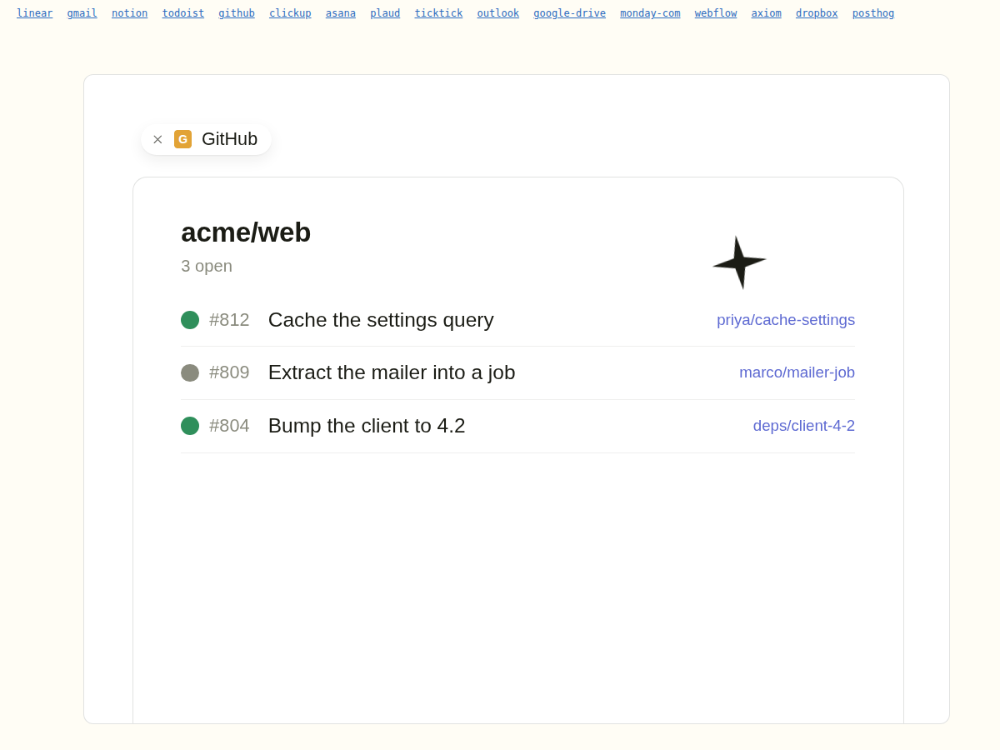
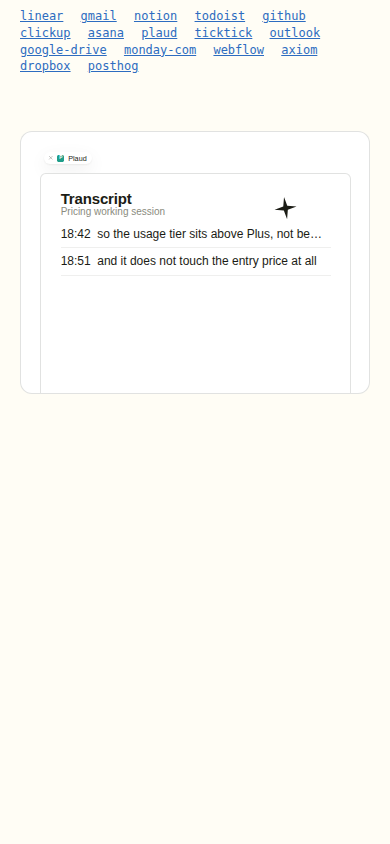

# See it work

A zero-dependency animation engine that puts a looping, scripted product demo on every
integration page of a marketing site, from one 48 KB embed. Each page gets a different
demo (question, tool steps, result panel) keyed by its URL slug, while the surrounding
product chrome stays byte-identical. Pure HTML, CSS and vanilla JS. No video files, no
framework, no build step on the site.



Shipped on 16 integration landing pages of an AI assistant's Webflow site. Three of those
pages had real screen recordings; the engine detects that and steps aside. The rest had
no footage at all, which is why this exists: a hero animation for every page at the cost
of a Python dict entry rather than a recording session.

The product name and asset URLs from that deployment are replaced with a fictional
product ("Kestrel") and monogram tiles, so this repo runs as-is.

## How it works

```
demos.py  ─────┐
               ▼
           build.py  ──►  embed.html (documented source, ~60 KB)
               │            │
               │            ├──►  embed.css.deploy.html  (styles, minified)
               │            └──►  embed.js.deploy.html   (data + engine, minified)
               │                       │
               ▼                       ▼
           gate.py              pasted once into the shared page template
        (string checks)                │
                                       ▼
                        page loads ──► read slug from URL ──► DEMOS[slug]?
                                                      no  ──► return (generic page untouched)
                                                      yes ──► mount stage, run beats, loop
```

**One embed, many pages.** The embed sits on the shared template. On load it reads the
last path segment, looks it up in `DEMOS`, and returns if there is no entry. Pages
without a demo are untouched by construction, not by a filter someone has to maintain.

**Data-driven scenes.** Every demo is a dict in `demos.py`: panel type, and one to three
*beats*. A beat is a typed question, a tool card title, two or three step rows, and a
result panel with its rows. The build serialises this to JSON and inlines it ahead of the
engine. Ten panel renderers (issues, mail, docs, checks, repos, recordings, board, cms,
query, files) make the result panels differ per tool family while the composer, bubble,
tool card and step list stay identical.

**Fixed 4:3 stage, container-query units.** Reference geometry was measured off three
real 1440x1080 product recordings (`docs/GEOMETRY.md`). Every dimension is expressed in
`cqw` (1 cqw = 1% of stage width = 14.4 px of the reference frame) on a
`container-type: inline-size` stage with `aspect-ratio: 4/3`. Proportions hold at any
width and the stage never reflows the page around it.

**Three acts, CSS-timed.** Act 1 types the question into a composer (~33 ms/char,
measured). Act 2 swaps to the transcript: user bubble, tool card with an indigo highlight
that orbits the card's 1 px ring (a rotating conic gradient on a square pseudo-element,
clipped by the rounded wrapper, masked by the opaque card face), and step rows that
reveal one at a time with not-yet-started steps shown as dimmed icons. Act 3 is a hard
cut to the result panel, rows populating one by one. Then it settles and loops.

**Logos sized from measured ink, not canvas.** A square icon in 83% transparent padding
and a tight 6:1 wordmark have to render at one visual height in the chip, the pill and
the page hero. `tools/measure_ink.py` reads the actual pixels, emits the ink aspect, and
the stylesheet cuts an `object-fit: cover` box to that aspect. Wordmarks (aspect > 2)
drop to 60% cap height. One CSS rule per logo, no per-tool fudge numbers. Without a
`logos.json` the engine falls back to a monogram tile.

**Reduced motion is a first-class path.** `prefers-reduced-motion` renders the settled
final transcript with no auto-loop. iOS sets that preference from Low Power Mode as well
as the accessibility switch, so an earlier version that hid the control under reduced
motion produced a blank still frame for anyone on a low battery. Now every automatic
start goes through `autoStart()`, which refuses under reduced motion; only an explicit
tap on the stage calls `start()`, because that is the user asking for motion.



**Reads only.** No demo animates a write, even for integrations that support them. A
hero animation on a landing page is high-volume marketing copy; "Sending the reply" is a
claim that needs sign-off, "Reading the thread" is not. Variation comes from panel type,
beat count and question phrasing, never from escalating to writes. `gate.py` enforces
this with a write-verb check over every rendered string.

## Why two deploy blocks

Webflow caps a single HTML embed at 50,000 characters and the combined artifact was
~51.6k. The split is on the only seam with no load-order dependency: a stylesheet loads
in either order, `var DEMOS` must precede the engine IIFE, so data and engine stay
together and styles go in a sibling embed. `build.py` asserts both blocks are under the
cap on every build.

## Run it

```
python3 gate.py                       # string checks; exit 1 on any fail
python3 build.py                      # regenerates embed.html + both deploy blocks
python3 harness.py && python3 sheets.py
python3 -m http.server 8744 --directory harness
```

Then open `http://localhost:8744/integrations/github/` for one page,
`/settled.html` for every demo's final frame on one sheet, `/mobile.html` for 390 px
versions in both motion modes, and `?rm=1` on any page to force the reduced-motion path
from a desktop browser. The harness mirrors the production DOM just enough for the embed
to mount (`.int-hero > .int-ctr > .int-demo-media`) and puts each page at
`/integrations/<slug>/` so the slug gate resolves exactly as it does live.

To add a demo: add a dict to `demos.py`, run `gate.py`, run `build.py`, paste the two
deploy blocks into the template. There is no second place to edit.

## Layout

```
demos.py          the source of truth: one dict per integration page
build.py          CSS + engine JS + serialiser + deploy splitter
gate.py           deterministic checks over every on-screen string
harness.py        one local page per slug + a generic negative-test page
sheets.py         contact sheets: settled frames, mobile, reduced motion
tools/measure_ink.py   logo ink-box measurer, emits logos.json entries
docs/GEOMETRY.md  the measurements behind every cqw value
embed.html        generated, documented source (committed for reading)
embed.*.deploy.html    generated, what gets pasted into the site
```

## What production taught me

- **Measure, don't remember.** The first build invented window chrome, a bot avatar and
  thinking dots from generic chat-app convention; none of it was in the real product. The
  second drew a partner's logo from memory and shipped a purple blob. Everything now comes
  from frame extraction or the site's own asset store.
- **A still frame with no control is a bug, not a fallback.** The iOS Low Power Mode
  report above. Reduced motion means fewer animations, never fewer affordances.
- **Generate the deploy artifact every build.** The deploy blocks used to be produced by
  a separate call and once sat a build behind the data file with nothing to say so.
- **Gate strings in the data file, not in the DOM.** Every on-screen string ran through
  the same claim checks as page copy (section lookup, composed-claim detection, held
  verbs, per-tool do-not-claim lists) before a build was allowed. The LLM fact-check
  layer caught one composed claim the deterministic pass had cleared. That library is
  not in this repo; `gate.py` keeps the portable checks and a hook for your own.
- **Decide "real footage wins" in data.** Pages with a real recording carry
  `video=True` and the engine returns early. Their demos are still written and gated,
  so flipping the decision is deleting one flag.
